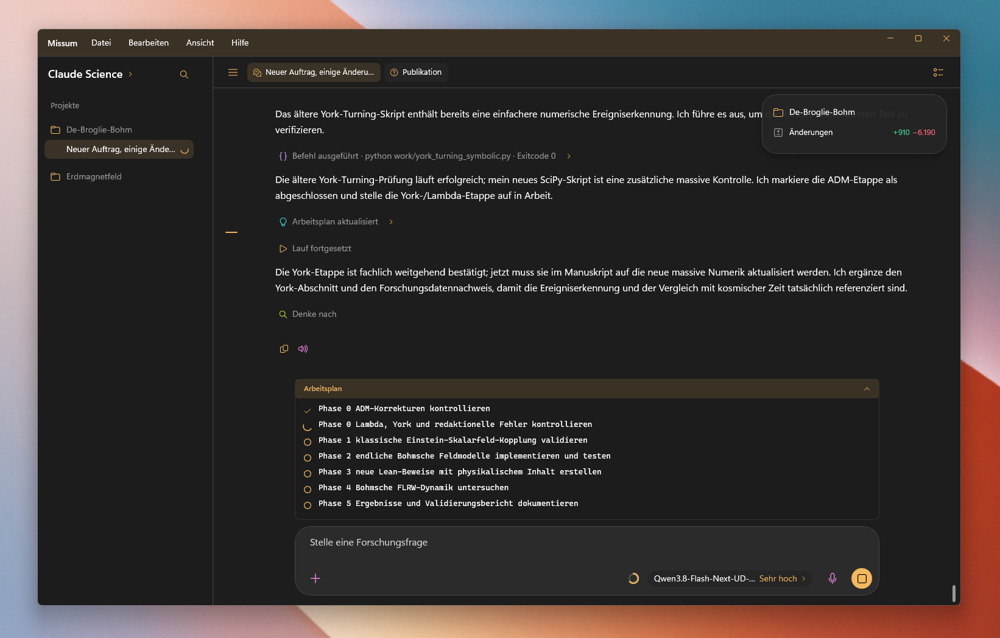



# Missum

Native WinUI 3 desktop application inspired by the supplied ChatGPT/Codex reference.
The desktop chat uses XAML controls. Missum includes its coordinator, SQLite
storage, local tool broker, model runtime and Docker gateway.

## Build and run

Windows 10 19041+ / Windows 11, .NET SDK 10, Windows App SDK.

    dotnet build src/Missum.App/Missum.App.csproj -c Release -p:Platform=x64
    .\src\Missum.App\bin\x64\Release\net10.0-windows10.0.19041.0\win-x64\Missum.exe

    .\Start-Missum.ps1

The launcher uses the newest existing Release or portable executable, and builds
Release if neither exists. For a self-contained portable distribution:

    .\windows\build.ps1

This produces `artifacts/portable/win-x64/Missum.exe` and its separate
`ExtensionHost` companion folder. Keep that folder beside the executable for
extension tools. The desktop executable extracts its bundled native runtime and
XAML resources automatically. `-Mode Folder` creates a conventional distribution
under `artifacts/windows/app-win-x64-folder` instead.

The normal build restores, compiles and publishes without tests or a startup smoke.
It still creates the publish manifest and verifies the executable hash.
Build and validation are separate; run the test or smoke scripts explicitly when needed.

Invoking `windows/publish.ps1` directly runs a native startup smoke check by default. It verifies all
manifest hashes, launches a fresh isolated profile, confirms the native page has
opened a persisted chat, and checks that WebView2 profiles are confined to the
internal document viewers. Smoke runs do not start
or stop shared model services. This checks packaging and native startup; it does
not replace a live model response and tool run.

Run the client regression suite separately with `./windows/test.ps1`, and the
context/server checks with `./windows/test-agent-context.ps1`. Run build and test
scripts sequentially so outputs are not locked by concurrent builds.

## Native desktop and document views

Missum runs exclusively as a native WinUI application. It does not start a LAN
assistant website or a browser speech service. The gateway remains the local
connection to the model and tools; it does not host a browser assistant.

Chats, projects, settings and files stay on the PC. Read-aloud, microphone,
voice control and screen capture use the native Windows services. Read-aloud
controls belong to the source message footer.

The Publication and Simulation tabs retain their embedded PDF and HTML document
viewers. These internal viewers provide PDF navigation, zoom and scrolling and
interactive simulations. They are independent of the removed browser assistant.
The PDF exporter uses the bundled Markdown/KaTeX resources in
`Assets/DocumentRendering` and requires no CDN.

## Data and models

Missum stores its own chats and settings in %LOCALAPPDATA%\Missum.
The default gateway is http://127.0.0.1:8080. The Missum Docker stack and
native model runtime serve the local application. Select an installed local model
in the composer. A ChatGPT subscription does not provide these local models.

The file deploy/missum-ai/compose.yaml defines the Missum deployment. Do not
start a duplicate on the same ports. See docs/DOCKER.md.

## Interface

The native window opens directly on the AI assistant; the Datei menu links the
AI assistant and settings without an additional outer navigation rail.
Switch ChatGPT/Codex/Claude Science above the session list. Enter sends, Shift+Enter adds a line.
Sessions, mode, project workspace and drafts persist locally.
Claude Science uses the same project tools as Codex. Its editable `Publikation.md`
and project files live directly in the selected workspace. The publication PDF
keeps the existing layout and linked contents; plots and explained Lean proofs belong
in their topic sections. Web search, Lean and simulations are optional evidence paths.
Right-click a chat to rename/delete it. Attachments and file changes appear in
the floating output overlay. Tool calls use the Missum coordinator and local tool broker.

Chat formulas support inline `$...$` / `\(...\)` and display `$$...$$` / `\[...\]`
notation, including fractions, roots, sums, integrals, aligned equations and matrices.
The native desktop uses CSharpMath/SkiaSharp for the shared LaTeX/KaTeX syntax;
it does not host the JavaScript KaTeX engine or support every KaTeX extension.
Code examples remain literal, unfinished streaming formulas wait for their closing
delimiter, and unsupported formulas retain their readable source. Click a formula
to copy its original LaTeX. No browser or network is needed for typesetting.
The portable smoke verifies native inline/display rendering, streaming transitions
and safe fallbacks, and writes a `.math-preview.png` beside the publish manifest.

## Provenance and validation

Base: the supplied local template snapshot at commit 86d27c8. Projects and
namespaces are branded Missum; explicit legacy readers preserve older data.
Historical validation documents copied from that template describe prior runs.
Current Missum evidence is recorded separately in docs/visual-validation/.
App icon: supplied Missum_Logo.png, converted to a 256px PNG-backed Windows icon.
See docs/visual-validation/ for reference and staged runtime screenshots.
